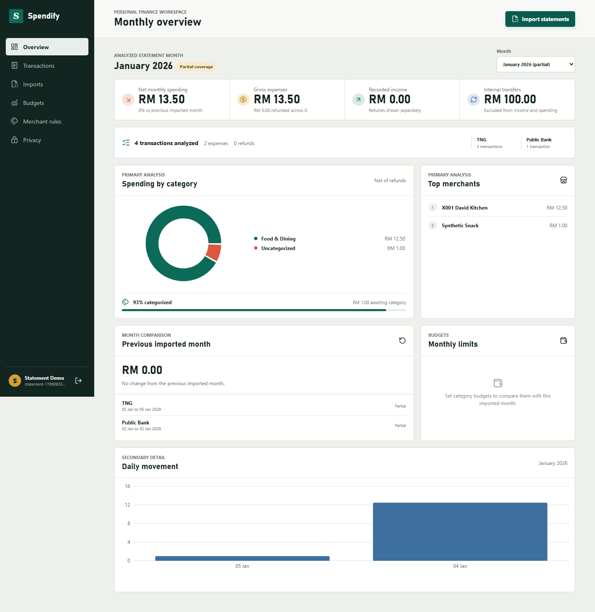
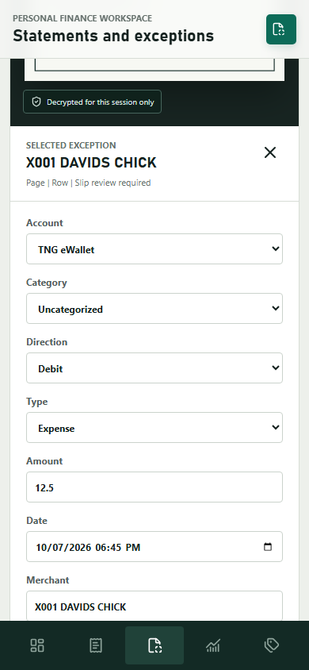
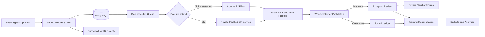

<div align="center">

# 💸 Spendify

### Turn bank and eWallet records into clear, privacy-conscious spending insights

Upload monthly Public Bank and TNG eWallet statements, let Spendify validate and
post clean transactions automatically, and review only genuine exceptions.
Wallet top-ups are reconciled so the same money is not counted twice.


</div>

## 🎯 The Problem

Expense tracking becomes tedious when every purchase must be entered manually.
Batch-uploading transaction slips is easier, but it creates a harder accounting
problem: a bank debit used to top up an eWallet must not be treated as an
expense when the wallet later records the real purchase.

Spendify solves this with **whole-statement validation**, deterministic
categorization, exception-only review, and explainable transfer reconciliation.
Clean rows become useful monthly analysis without repetitive confirmation.

### A simple example

| Record | Amount | Spendify treatment |
|---|---:|---|
| Public Bank top-up debit | -RM100.00 | Internal transfer |
| TNG top-up credit | +RM100.00 | Internal transfer |
| TNG merchant payment | -RM12.50 | Actual expense |
| **Monthly expense** | **RM12.50** | No double counting |

## ✨ What Spendify Does

| Capability | How it helps |
|---|---|
| 📥 Batch slip import | Accepts Public Bank and TNG PNG, JPEG, WebP, and PDF files |
| 📄 Statement import | Uses PDFBox to extract multiple rows from digital Public Bank and TNG PDF statements |
| 🔎 Private OCR | Runs self-hosted PP-OCRv6 without sending complete slips to an external AI service |
| ✅ Automatic statement posting | Validates the complete PDF and posts structurally sound rows, using a provisional category when needed |
| ⚠️ Exception-only review | Holds only suspicious, contradictory, potentially duplicated, or low-confidence rows for review |
| 🔁 Transfer reconciliation | Automatically resolves unique bank-to-wallet top-ups and presents ambiguous matches |
| 🧠 Merchant learning | Applies private aliases learned from the user's corrections |
| 📊 Monthly spending insights | Opens the latest closed imported month with net spending, refunds, categories, merchants, coverage, and budgets |
| 🧾 Transaction tools | Supports filters, editing, manual entry, duplicate warnings, and safe CSV export |
| 🔐 Protected storage | Encrypts each original document with AES-256-GCM and an independent file key |

## 🎬 Verified Demo



The real-stack statement workflow verifies complete-document validation,
automatic posting with provisional categories, date-only reconciliation,
coverage gaps, category-quality reporting, and date-filtered CSV export.
The overview reports **RM13.50** of synthetic purchases and keeps **RM100.00**
separate as an internal transfer.

The preserved slip workflow separately verifies private OCR, manual correction,
owner-scoped document access, ambiguous transfer review, and safe CSV export.

▶️ [Watch the synthetic end-to-end demonstration](docs/demo/spendify-real-demo.webm)

<p align="center">
  
</p>

## 🏗️ Architecture



The core is a Spring Boot modular monolith backed by PostgreSQL. OCR is isolated
as a private Python sidecar because PaddleOCR belongs naturally in that
ecosystem. Database-backed jobs keep the deployment straightforward without
introducing Kafka or RabbitMQ.

### Request-to-result workflow

1. `ImportService` validates the file signature, rejects an exact duplicate,
   encrypts the original, and creates an ingestion job.
2. A slip is sent to the private OCR sidecar; a digital statement is read with
   PDFBox. Public Bank and TNG parsers convert provider text into normalized
   rows with retained source-page evidence.
3. The statement is validated as a complete document. Structurally sound rows
   post automatically, using `Uncategorized` as a provisional category when no
   rule matches. Invalid documents post nothing; genuine accounting exceptions
   stay outside analytics until resolved.
4. The React exception workspace lets the user inspect and correct only held
   rows. Private merchant aliases reuse corrections without crossing users.
5. `ReconciliationService` automatically pairs unique bank-to-wallet top-ups.
   Ambiguous candidates remain visible for a decision, and transfers never
   enter income or expense totals.
6. The Overview opens the recommended closed imported month. Net spending,
   refunds, categories, merchants, coverage, budgets, and CSV export all read
   from the posted ledger.

### Technology stack

| Layer | Technology |
|---|---|
| Frontend | React 19, React Router 8, TypeScript, Vite, TanStack Query, Recharts, PWA |
| Backend | Java 21, Spring Boot 4.1, Spring Security, Spring Data JPA |
| Data | PostgreSQL 18, Flyway, MinIO |
| Document processing | Apache PDFBox, FastAPI, PaddleOCR, PP-OCRv6 |
| Testing | JUnit, Testcontainers, Vitest, Testing Library, Playwright |
| Local deployment | Docker Compose |

## 🔁 How Reconciliation Works

Spendify evaluates possible transfer pairs using evidence that remains visible:

| Evidence | Points |
|---|---:|
| Exact amount and opposite direction | 55 |
| Bank debit paired with eWallet credit | 15 |
| Transactions occur within 30 minutes | 15 |
| References contain related tokens | 15 |

Exact-time slips use a 30-minute window. Date-only statement rows allow two
calendar days, but also require an equal/opposite amount, a bank/eWallet pair,
and top-up evidence. A unique match is confirmed automatically. Competing or
uncertain matches remain pending for review. Confirmed pairs become `TRANSFER`
transactions and are excluded from income and expense totals.

### Edge cases and design choices

- **Validate before automation:** a statement must pass complete-document
  checks before any clean row can post; exceptions never affect analytics.
- **One-to-one transfer matching:** a transaction cannot be reused across two
  accepted transfer pairs, which prevents ambiguous double matching.
- **Duplicate versus transfer:** duplicate detection identifies repeated source
  evidence; reconciliation links two different records representing one money
  movement.
- **Fixed-precision money:** PostgreSQL numeric values and Java `BigDecimal`
  avoid binary floating-point errors in totals and comparisons.
- **Database jobs instead of a broker:** the workload is local and modest, so a
  durable database queue keeps operation and recovery visible without Kafka.
- **Optional external AI:** categorization can receive sanitized merchant text,
  but private OCR, deterministic rules, and the review workflow do not depend
  on an external model.

## Technical Checkpoints

| Question to explore | Source checkpoint |
|---|---|
| How are transfer candidates scored and confirmed? | `backend/src/main/java/com/wilson/spendify/finance/ReconciliationService.java` |
| How are originals encrypted before MinIO storage? | `backend/src/main/java/com/wilson/spendify/storage/DocumentCryptoService.java` |
| How are statement rows validated, posted, or held? | `backend/src/main/java/com/wilson/spendify/ingestion/StatementIngestionService.java` |
| How are database constraints and ownership boundaries verified? | `backend/src/test/java/com/wilson/spendify/finance/PostgresContractTest.java` |
| Where is the statement-first browser workflow? | `frontend/e2e-real/statement-workflow.spec.ts` |

## 🔒 Privacy by Design

1. File signatures are checked instead of trusting file extensions.
2. Every original receives a random 256-bit data-encryption key.
3. Each data key is wrapped by a local master key that is never committed.
4. Only encrypted document bytes are stored in MinIO.
5. OCR runs on a private Docker network and removes its temporary file.
6. Optional AI categorization receives sanitized merchant text only.
7. Financial APIs and previews use `Cache-Control: no-store`.
8. User ownership checks protect documents, transactions, rules, and budgets.

The application is local-first, but host security and key backup still matter.
Read the [privacy design](docs/privacy.md) for trust boundaries and limitations.

## 🚀 Run Locally

### Prerequisites

- Docker Desktop with Docker Compose
- At least 6 GB of available memory for the first OCR image build
- PowerShell on Windows

### Start Spendify

```powershell
git clone https://github.com/modyz0712/spendify-finance-reconciliation.git
cd spendify-finance-reconciliation
./scripts/init-local-env.ps1
docker compose up --build -d --wait
```

Open **http://localhost:5173**.

The OCR model is downloaded while its image is built. At runtime, the OCR
container stays on a private network without internet access. The first
recognition request may take longer while the in-memory model warms up.

### Stop Spendify

```powershell
docker compose down
```

For clean-database testing only:

```powershell
docker compose down --volumes --remove-orphans
```

This removes Spendify's local database and object-storage volumes.

## 🧪 Test the Project

```powershell
./scripts/test-local.ps1
./scripts/test-ocr-golden.ps1

cd frontend
npm run test:e2e
npm run test:e2e:real
```

The checks cover:

- backend unit tests and PostgreSQL Testcontainers contracts;
- Flyway migrations, monetary precision, indexes, and ownership boundaries;
- OCR API tests and PP-OCRv6 golden checks using synthetic slips;
- frontend lint, component tests, and production build;
- mocked and real-stack Playwright workflows;
- synthetic multi-row statement validation, automatic posting, exception-only
  review, coverage warnings, and date-filtered ledger export;
- encryption, duplicate handling, reconciliation, authorization, CSV safety,
  and document deletion.

See [local development](docs/local-development.md) for setup details and
[security verification](docs/security-verification.md) for release checks.
Running the frontend commands directly requires Node.js 22.22 or newer; the
Docker workflow already provides a compatible Node environment.

## 🗂️ Repository Guide

```text
backend/       Spring Boot API, Flyway schema, encryption, and finance logic
frontend/      Responsive React PWA and browser workflows
ocr-service/   Ephemeral FastAPI and PaddleOCR service
fixtures/      Synthetic Public Bank and TNG slips and digital statements
docs/          Architecture, privacy, demo, security, and interview notes
scripts/       Local setup and verification commands
```

Useful documentation:

- [Architecture and data model](docs/architecture.md)
- [Privacy design](docs/privacy.md)
- [Local development and troubleshooting](docs/local-development.md)
- [Private statement import workflow](docs/statement-import.md)
- [Repeatable demo script](docs/demo-script.md)
- [Technical interview guide](docs/interview-guide.md)
- [Security verification record](docs/security-verification.md)

## 📚 API Documentation

With Spendify running:

- Swagger UI: `http://localhost:5173/swagger-ui/index.html`
- OpenAPI JSON: `http://localhost:5173/v3/api-docs`
- Health check: `http://localhost:5173/actuator/health`

## 🧭 Current Scope

- Supports MYR and the `Asia/Kuala_Lumpur` time zone.
- Includes Public Bank/Public Islamic Bank and TNG eWallet slip and digital-statement parsers.
- Statement import is limited to calendar-year 2026 records and digital PDFs with embedded text.
- Uses synthetic slips for tests, screenshots, and demonstrations.
- Does not connect directly to live bank accounts.
- Does not provide forecasting, investment recommendations, or financial advice.
- Runs locally with Docker Compose; no public hosted service is operated.

## 📄 License

Spendify is released under the [MIT License](LICENSE).
