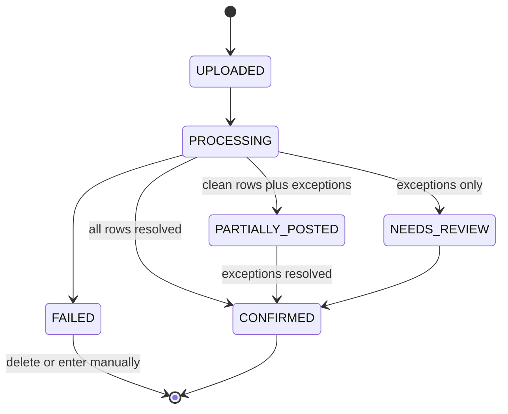
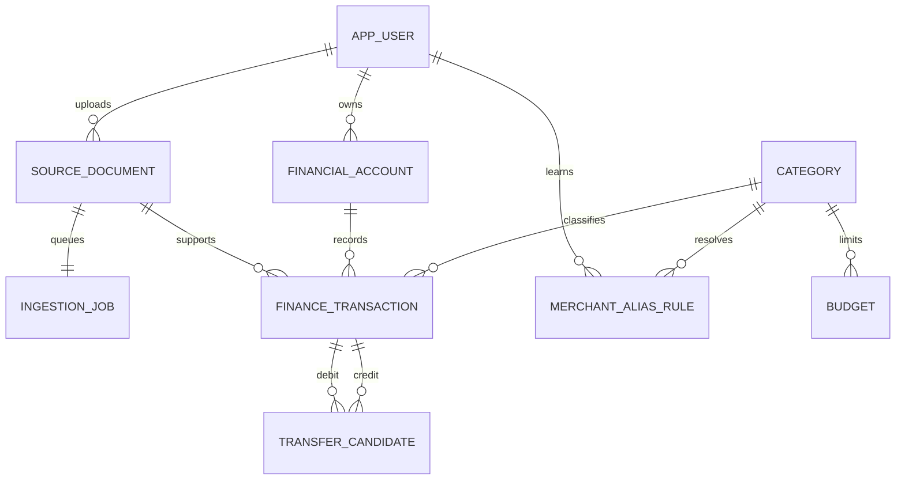

# Architecture

## Modules

| Module | Responsibility | Depends on |
|---|---|---|
| Identity | Registration, authentication, user boundary | PostgreSQL sessions |
| Ingestion | Validation, hashing, encryption, upload jobs, statement parsing | MinIO, PostgreSQL, PDFBox |
| OCR | Ephemeral text recognition | PaddleOCR |
| Finance | Automatic posting, exceptions, refunds, manual records | PostgreSQL |
| Categorization | Private aliases, seeded keywords, optional AI | Finance categories |
| Reconciliation | Unique auto-matches and explainable ambiguous proposals | Finance accounts |
| Analytics | Net monthly totals, refunds, categories, merchants, budgets | Posted transactions |

## Ingestion States

Documents and transactions have separate states. A slip creates one draft. A
statement creates ordered rows after complete-document validation. Structurally
sound rows post automatically; an unknown category remains a visible,
provisional `Uncategorized` value rather than blocking the ledger. Suspicious,
contradictory, or potentially duplicated rows remain exceptions.
`PARTIALLY_POSTED` means posted rows are already available while exceptions stay
outside analytics. Invalid documents post nothing. Analytics query only
`CONFIRMED` transactions.

## Data Model

Money uses `NUMERIC(14,2)`. Confirmed transfer indexes prevent a transaction
from joining more than one confirmed pair. `(document_id, source_sequence)` is
unique, and statement resolution cannot exceed its parsed row count.
